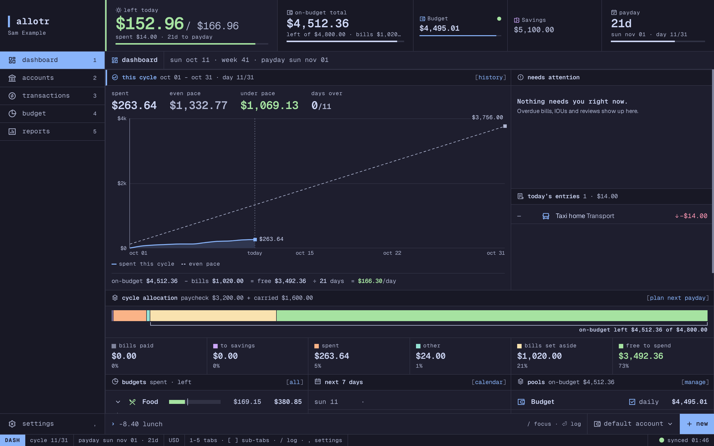
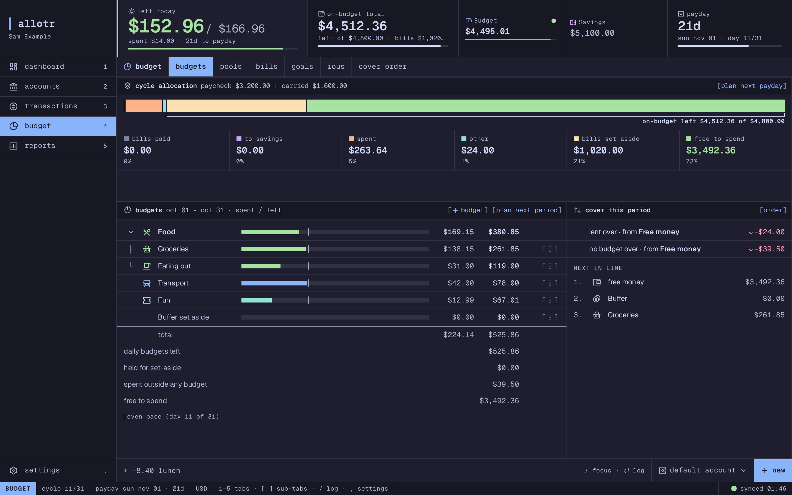
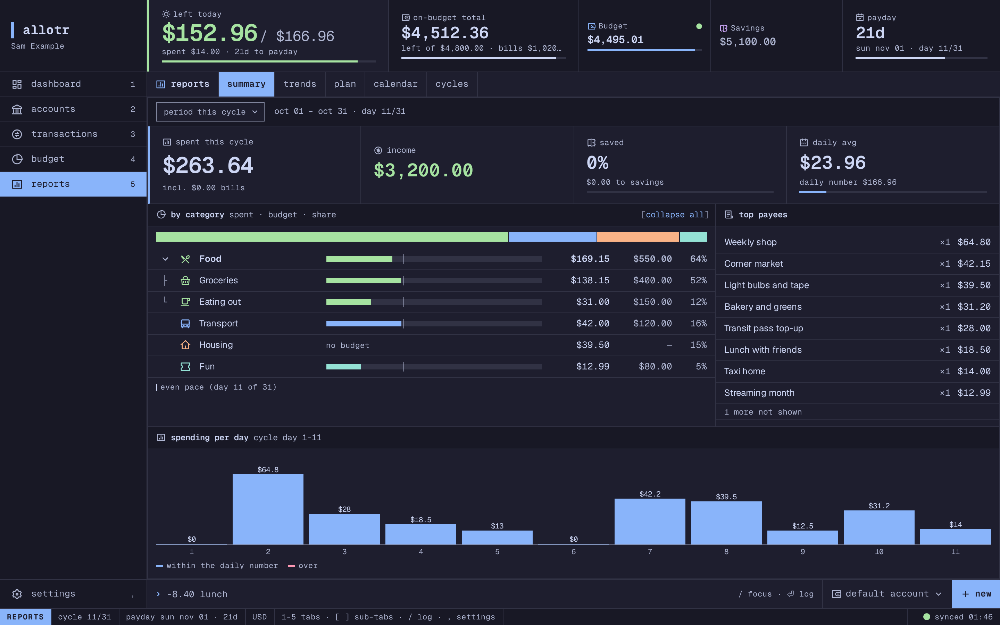
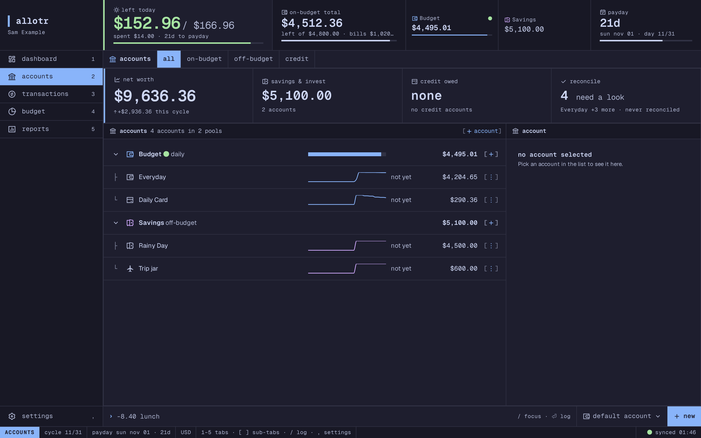
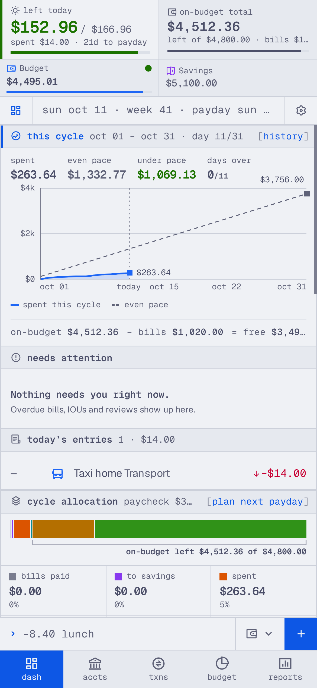

<div align="center">

# Allotr

**A self-hosted personal finance ledger that answers one question:<br>how much can I spend today?**

[](#project-status)
[](LICENSE)
[](package.json)
[](docs/adr/0003-typescript-node-stack.md)
[](docs/adr/0011-no-telemetry.md)



</div>

> [!WARNING]
> **Allotr is in active development.** The ledger, the web app and the
> self-hosted server run, but there is no release, no published image and no
> upgrade guarantee yet. Expect breaking changes, and do not rely on it for
> your only copy of your finances. See [Project status](#project-status).

The name comes from *allotment*: every unit of money has a job.

## The idea

Most budgeting apps compute "safe to spend" from your total balance, so money
you meant to save quietly becomes spending money. Allotr keeps spendable money
and savings apart:

```
daily usable = (on-budget balance − bills set aside) ÷ days until payday
```

Savings live in off-budget accounts and **never** count toward the daily
number. You open the app and see one figure: what is left for today.

## Screenshots

All screenshots show made-up data.

<table>
  <tr>
    <td width="50%"></td>
    <td width="50%"></td>
  </tr>
  <tr>
    <td align="center"><b>Budget</b> · budgets, set-asides and the cover order</td>
    <td align="center"><b>Reports</b> · category tree, payees and daily spending</td>
  </tr>
  <tr>
    <td width="50%"></td>
    <td width="50%" align="center"></td>
  </tr>
  <tr>
    <td align="center"><b>Accounts</b> · pools, balances and net worth</td>
    <td align="center"><b>Phone</b> · the same app, installable as a PWA</td>
  </tr>
</table>

## Features

**Ledger you can trust**

- Double-entry, append-only ledger. Money is stored as integer minor units
  with a currency on every amount, and each currency balances on its own.
- Edits and deletes post reversals; nothing is ever removed, and earlier
  versions can be restored.
- Back-dated entries, even into closed cycles, correct every affected figure.
- All ISO 4217 currencies, a switchable default currency, and cross-currency
  entries that record both real amounts.

**Budgeting that matches how you get paid**

- **Paycheck cycles** instead of calendar months, with a predicted next
  payday you can override.
- **Pools and budgets**: group accounts into pools (Budget counts toward the
  daily number, Savings does not) and plan amounts per category, tag or
  period without moving any money.
- **Cover**: when a budget runs out, the shortfall is covered in an order you
  choose (free money, then a Buffer, then other budgets), and bills are never
  touched.
- **Bills** reserved ahead of their due date, **savings goals** on top of
  off-budget accounts, and **IOUs** for money lent or borrowed, including
  split bills.
- A **payday sheet** to allocate a paycheck in one step, plus an emergency
  fund target, net worth over time and a weekly review.

**A web app that feels like a terminal**

- Responsive PWA for phone, tablet, desktop and wall displays: tab bar, icon
  rail or sidebar depending on width.
- A flat, keyboard-first terminal design system with light, dark and
  community palettes, fitted to WCAG 2.2 AA contrast.
- A command line on every screen for quick entry, in-app menus instead of
  native pickers, and every figure computed by the server, never the browser.
- Reports with a category tree, trends, a plan view, a spending-and-bills
  calendar and a history of closed cycles.

**Self-hosted and private**

- Multi-user with invites, local accounts and TOTP two-factor sign-in.
- Reminders for bills, IOUs and the weekly review, with opt-in Web Push.
- Export all your data at any time as JSON, CSV or Beancount; import through
  the CLI.
- **No telemetry, ever** ([ADR 0011](docs/adr/0011-no-telemetry.md)).

## Project status

Allotr is built in milestones (see the [PRD](docs/PRD.md#9-release-plan)).
This is where things stand today:

| Area | State |
|---|---|
| Ledger, cycles, daily number, currencies | Working |
| Pools, budgets, cover, bills, goals, IOUs | Working |
| Web app (dashboard, accounts, transactions, budget, reports, settings) | Working, rebuilt on the terminal design system |
| Auth with 2FA, invites, reminders, export to JSON, CSV and Beancount | Working |
| CLI import and export | Working |
| Natural-language input and chat gateways (Discord, Telegram) | Planned, grammar is [specified](docs/grammar.md) |
| Optional AI assistant and MCP server | Planned |
| OIDC, offline entry queue, kiosk view, importers for bank files | Planned |
| Published Docker image and `v1.0.0` | Not yet |

### What natural-language input will look like

The command line you see in the app is the start of one grammar shared by the
web app, chat apps and AI agents:

```
-12.50 food
✓ -$12.50 Food · Daily Card
Today left: $27.50 · $40.00/day for 24 days
```

## Try it

There is no published image yet, so build from source. You need Node.js 24,
[pnpm](https://pnpm.io) (via `corepack enable`) and, for the container,
Docker.

```sh
git clone <repository-url> allotr
cd allotr
corepack enable
cp .env.example .env     # set ALLOTR_SECRET_KEY: openssl rand -base64 32
make dev                 # server, web and gateway in watch mode
```

Open <http://localhost:5173> and create the first account.

To run the single container instead:

```sh
cp deploy/.env.example deploy/.env    # set ALLOTR_BASE_URL and ALLOTR_SECRET_KEY
docker compose -f deploy/docker-compose.yml up -d --build
```

Allotr is meant to be reached over a VPN or a reverse proxy, not exposed
directly to the internet. Serve it over HTTPS where you can: over plain HTTP
(other than `localhost`) browsers still let you use it, but not install it as
an app or open it offline.

## Built with

| | |
|---|---|
| Language | TypeScript on Node.js 24 LTS |
| Monorepo | pnpm workspaces, Turborepo |
| Server | Hono, Zod (OpenAPI generated), Better Auth |
| Storage | SQLite through Kysely, forward-only SQL migrations |
| Web | React, Vite, installable PWA |
| Integrations (planned) | Vercel AI SDK, MCP SDK, discord.js, grammY |
| Quality | Vitest, fast-check, Playwright, strict ESLint, Prettier |
| Packaging | One Docker image with s6-overlay, amd64 and arm64 |

```
packages/core      domain, policies, invariants: pure, no I/O
packages/parser    grammar, aliases
packages/shared    Zod schemas, money and currency utilities
apps/server        API, auth, persistence, scheduler
apps/web           React PWA
apps/gateway       chat platform adapters
apps/cli           import and export
```

Dependencies only point one way: `apps/* → parser → core → shared`.

## Documentation

| Doc | What is in it |
|---|---|
| [Product requirements](docs/PRD.md) | What each feature must do, with priorities and milestones |
| [Architecture](docs/architecture.md) | Components, flows, API and configuration |
| [Domain model](docs/domain.md) | Money, accounts, cycles, policies |
| [Grammar](docs/grammar.md) | The entry and chat command language |
| [UI design system](docs/ui.md) | Tokens, components, patterns and screens |
| [Decisions](docs/adr/) | Accepted Architecture Decision Records |
| [Privacy](docs/privacy.md) | What leaves your server, and when |

## Privacy

- **No telemetry.** No analytics, crash reporting or install counting.
- Every outbound network call belongs to a feature you turn on (AI provider,
  exchange rates, chat platforms, OIDC, update check) and is listed in the
  app's privacy settings.
- Your data stays on your server.

## Contributing

Read [CONTRIBUTING.md](CONTRIBUTING.md). In short: branch from `dev`, use
Conventional Commits, sign off your commits (`git commit -s`), link an issue,
and never include real financial or personal data. AI coding agents should
start with [AGENTS.md](AGENTS.md).

Security issues: see [SECURITY.md](SECURITY.md).

## Name and brand

"Allotr" and its logo identify this project. You are welcome to fork the code
under the MIT license. If your fork changes behaviour and is distributed or
hosted for others, please give it a different name and logo so users can tell
the projects apart.

## License

[MIT](LICENSE)

The web app bundles the Geist and Geist Mono typefaces, licensed under the
SIL Open Font License 1.1. Other third-party licences are listed in
[THIRD_PARTY_NOTICES.md](THIRD_PARTY_NOTICES.md).
